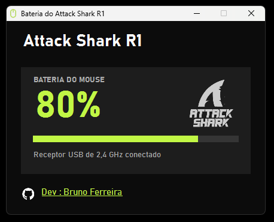
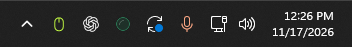
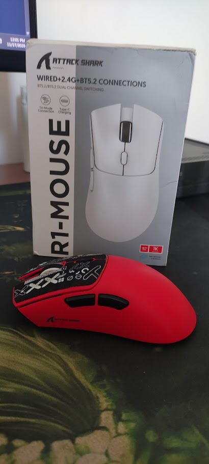

  
  <h1>MouseAS</h1>
  
Monitor de bateria do Attack Shark R1 para Windows.

  
<a href="https://github.com/bruninho182/MouseAS/releases/latest">Baixar para Windows</a> · <a href="#como-usar">Como usar</a> · <a href="#compilar">Compilar</a>

  

## Como usar

1. Abra a página de [Releases](https://github.com/bruninho182/MouseAS/releases/latest).
2. Na seção **Assets**, baixe **BateriaR1.exe**.
3. Conecte o receptor USB e coloque o Attack Shark R1 no modo **2,4 GHz**.
4. Abra o executável. Se o painel estiver aguardando uma leitura, mova ou clique no mouse.
5. Feche ou minimize o painel para continuar monitorando pela área de notificação, perto do relógio.

Passe o cursor sobre o ícone para ver a porcentagem e clique para reabrir o painel. Se o ícone estiver na lista de ícones ocultos, abra a seta **^** e arraste-o para perto do relógio. Para encerrar o monitor, clique com o botão direito e escolha **Sair**.

### Iniciar com o Windows

Clique com o botão direito no ícone do MouseAS e marque **Iniciar com o Windows**. Na próxima vez que você entrar na sua conta, o monitor abrirá na área de notificação com a janela oculta. Clique na opção novamente para desativar.

Guarde o executável em uma pasta fixa antes de ativar a opção. Se mover o arquivo, abra-o pelo novo local e marque a opção novamente.

## Leituras e carregamento

| Situação | O que aparece |
| --- | --- |
| Receptor de 2,4 GHz com leitura recente | Porcentagem no painel e ao passar o cursor sobre o ícone. |
| Até 15% | Ícone e barra vermelhos. Como o R1 informa a carga em passos de 10%, o primeiro valor abaixo do limite costuma ser 10%. |
| Cabo USB detectado | O ícone ganha um raio. O aviso de carregamento é estimado pela presença do cabo. |
| USB sem leitura atual | O painel mostra a última leitura da sessão, se houver, ou um traço enquanto aguarda dados. |

A leitura em tempo real foi testada com o receptor de **2,4 GHz**. O modo Bluetooth fica fora do escopo do projeto. O app é portátil e escuta os relatórios HID do mouse.

## Compilar

Em uma instalação do Windows com o compilador do .NET Framework e as bibliotecas WPF disponíveis, abra o PowerShell na raiz do projeto:

~~~powershell
$f = "$env:WINDIR\Microsoft.NET\Framework64\v4.0.30319"
& "$f\csc.exe" /nologo /target:winexe `
  "/r:$f\WPF\PresentationCore.dll" "/r:$f\WPF\WindowsBase.dll" `
  "/r:$f\System.Xaml.dll" /resource:AttackShark.png,AttackShark.png `
  /out:BateriaR1.exe MouseBattery.cs
~~~

Para abrir diretamente na área de notificação, execute `.\BateriaR1.exe --tray`.

## Mouse usado no teste

Projeto independente de [Bruno Ferreira](https://github.com/bruninho182). A marca Attack Shark pertence ao seu titular. O ícone do GitHub vem do [Primer Octicons](https://github.com/primer/octicons), distribuído sob licença MIT.

